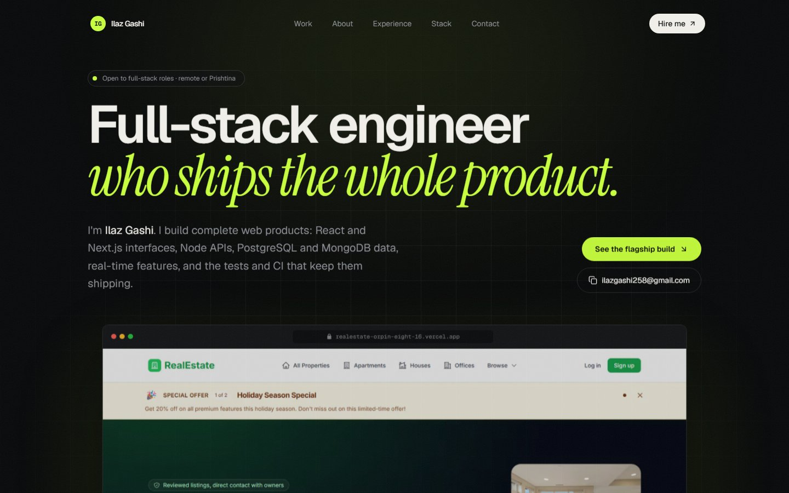

# Ilaz Gashi — Portfolio

[](https://github.com/iligashi/ilazgashiportfolio/actions/workflows/ci.yml)


[](LICENSE)

Personal site of Ilaz Gashi, full-stack engineer based in Prishtina, Kosovo.

**Live:** [ilazgashi.vercel.app](https://ilazgashi.vercel.app)

[](https://ilazgashi.vercel.app)

## Highlights

- **Flagship case study as a scroll story.** The Real Estate Marketplace section pins a browser frame and swaps
  real product screens as each chapter scrolls past, ending on an animated architecture diagram.
- **Honest content.** Every project image is a screenshot of the live site, and every number comes from the
  project's repository. Projects without a public demo use cover art labelled as an illustration.
- **Fast first paint.** Pages are statically generated. Above-the-fold text uses CSS-only entrance animations, so it
  renders on the first frame without waiting for JavaScript.
- **Accessible motion.** All animation respects `prefers-reduced-motion`. The page has a skip link, visible focus
  styles, semantic landmarks and labelled controls.
- **Social previews.** The Open Graph image is generated at build time from `app/opengraph-image.tsx`.

## Tech stack

| Area      | Choice                                                             |
| --------- | ------------------------------------------------------------------ |
| Framework | Next.js 15 (App Router, static generation), React 19               |
| Language  | TypeScript (strict)                                                |
| Styling   | Tailwind CSS v4, design tokens as CSS variables in `globals.css`   |
| Motion    | [Motion](https://motion.dev) for scroll-linked and in-view effects |
| Type      | Geist Sans, Geist Mono, Instrument Serif                           |
| Quality   | ESLint (`next/core-web-vitals`), Prettier, GitHub Actions CI       |
| Hosting   | Vercel, with preview deployments for every pull request            |

## Project structure

```
app/
  layout.tsx               Root layout, fonts, metadata
  page.tsx                 Home page composed from sections
  projects/[slug]/         Statically generated case-study pages
  opengraph-image.tsx      Generated social preview image
components/
  motion/primitives.tsx    Reveal, SplitWords, Magnetic and spotlight helpers
  site/                    Page sections: hero, flagship, work grid, about, experience, stack, contact
lib/
  site.ts                  Profile, experience, capabilities and stack content
  projects.ts              Projects and case-study content
public/                    Screenshots and portrait
```

Content lives in `lib/`, separate from presentation, so updating a role or adding a project means editing data,
not markup.

## Getting started

Requirements: Node.js 20+ (see `.nvmrc`) and pnpm 9.

```bash
pnpm install
pnpm dev        # http://localhost:3000
```

| Script           | What it does                                       |
| ---------------- | -------------------------------------------------- |
| `pnpm dev`       | Start the development server                       |
| `pnpm build`     | Production build (includes lint and type checks)   |
| `pnpm start`     | Serve the production build                         |
| `pnpm lint`      | Run ESLint                                         |
| `pnpm typecheck` | Run the TypeScript compiler without emitting files |
| `pnpm format`    | Format all files with Prettier                     |
| `pnpm check`     | Lint, typecheck and format check in one go         |

## Continuous integration

Every push to `main` and every pull request runs lint, typecheck, format check and a production build
([`ci.yml`](.github/workflows/ci.yml)). Dependabot opens grouped weekly dependency updates.

## License

The source code is released under the [MIT License](LICENSE). The written content, portrait, project screenshots and
client work shown on the site are not licensed for reuse.

## Contact

[ilazgashi258@gmail.com](mailto:ilazgashi258@gmail.com) · [LinkedIn](https://www.linkedin.com/in/ilaz-gashi-a2b868259) ·
[GitHub](https://github.com/iligashi)
